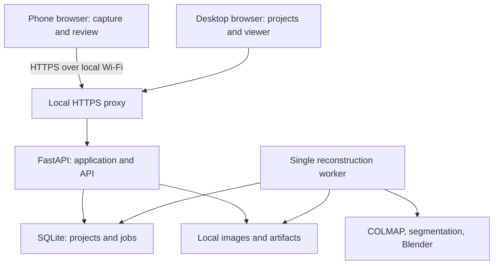

# Local Phone-to-3D Scanner — Implementation Plan

## 1. Goal and scope

Build an application that uses a phone camera to capture a real object, transfers images directly to a computer on the same local network, reconstructs a textured triangle mesh on that computer, and lets the user preview and export the result.

**Architecture assumption:** “local” means phone capture plus processing on the user's computer. This plan does not assume all reconstruction runs on the phone. Confirm that assumption before implementation if phone-only operation is required; that would change the architecture substantially.

**Initial experience:** live camera preview and capture guidance, followed by batch reconstruction. Geometry does not update live in the MVP. Processing may take minutes or longer depending on hardware, image count, resolution, and object complexity; measure rather than promise a fixed duration.

### Required deliverables

- Mobile-friendly capture interface and desktop project dashboard.
- Trusted local HTTPS connection between phone and computer.
- Resumable image uploads and persistent scan projects.
- Local photogrammetry pipeline producing a textured mesh.
- Local pretrained segmentation model integrated into object selection and cleanup.
- Interactive 3D viewer with non-destructive crop, orientation, and scale controls.
- GLB export; OBJ with associated material/texture files as a secondary export.
- Setup scripts, dependency checks, diagnostic logs, test datasets, and documentation.
- No runtime dependency on cloud APIs, hosted models, CDNs, analytics, or internet connectivity after dependencies and model weights are installed.

### Explicitly deferred

- Continuous real-time mesh reconstruction.
- Training a foundation image-to-3D model from scratch.
- Guaranteed measurement accuracy or fabrication-ready geometry.
- Automatic recovery of unseen surfaces.
- Native phone apps, LiDAR, multi-user accounts, public hosting, and remote access.
- Turntable capture and combining scans after flipping an object.
- STL export until mesh validation and scale handling are implemented.

## 2. Core decisions

| Area | Decision | Reason |
| --- | --- | --- |
| Frontend | React, TypeScript, Vite | Mobile capture plus desktop viewer in one UI |
| Viewer | Three.js with React Three Fiber and Drei | Camera controls, model loading, selection tools |
| Backend | Python, FastAPI, Pydantic | Integrates with computer vision tools |
| Persistence | SQLite plus ordinary local directories | Simple installation and durable state |
| Jobs | Separate Python worker process, SQLite-backed queue | Long tasks survive frontend disconnects |
| Progress | HTTP polling initially | Simple reconnect behavior; no streaming dependency |
| Sparse reconstruction | COLMAP CLI through an adapter | Camera pose estimation and sparse geometry |
| Dense reconstruction | Validated COLMAP backend on supported hardware | Depth maps and fused geometry |
| Texturing | Validated pinned COLMAP texturer, or explicit OpenMVS adapter | Do not assume every installed COLMAP build includes texturing |
| Mesh export | Blender in background mode | Mesh processing and GLB/OBJ export |
| ML | Local SAM 2 image predictor, prompted per selected view | Meaningful segmentation with human correction |
| HTTPS | Local reverse proxy and locally trusted certificate | Phone browser camera access |
| Packaging | Native host scripts first | Avoid GPU/container/network setup complexity |

Pin exact working versions after the reconstruction spike. Record executable paths, tool versions, GPU driver details, dependency licenses, model checkpoint SHA-256, and configuration in a machine-readable environment manifest. Do not use floating `latest` dependencies for the reproducible release.

## 3. Hardware and operating-system feasibility gate

Complete this before building the full frontend.

1. Inventory the target computer: OS, CPU, RAM, GPU, VRAM, available storage, driver, and Python/Node support.
2. Select one primary development platform. Windows native is a reasonable candidate, but validate the chosen reconstruction binaries there first. Linux can be the alternative if tool support is better. Avoid splitting the MVP between Windows and WSL unless required.
3. Install COLMAP and Blender; inspect their actual CLI help and available commands.
4. Run a known overlapping image set through sparse reconstruction, dense reconstruction, meshing, texturing, and GLB conversion.
5. Open the GLB in both the browser viewer and Blender. Verify geometry, textures, material references, orientation, and file portability.
6. Repeat with one phone-captured textured object.
7. Save runtime, peak memory, peak VRAM if available, image registration rate, output size, and visual observations.

**Hardware planning envelope, not minimum requirements:** aim for 16–32 GB RAM, an SSD with tens of GB free for projects and temporary data, and a supported discrete GPU where the selected dense backend needs it. A modest sparse reconstruction can run on a CPU, but do not imply that this guarantees a complete CPU-only dense pipeline.

**Gate:** choose a proven full reconstruction backend for the user's actual computer. If the standard dense stage cannot run, separately evaluate an OpenMVS configuration supported by that hardware. Validate it end to end before advertising it as a fallback. If no backend works, report the hardware blocker rather than returning a sparse point cloud as a completed mesh.

## 4. Local architecture



The backend serves the built frontend and API under one origin. The proxy exposes one HTTPS LAN port; the API and worker control interfaces remain on loopback. The phone never needs access to a database or reconstruction executable.

### Process model

- One API process and one worker process initially.
- Worker atomically claims one queued job using a short SQLite transaction; do not hold database transactions while running reconstruction.
- Enable SQLite WAL and bounded busy timeouts. Keep one active reconstruction job to control RAM/VRAM use.
- Worker launches child tools as separate subprocesses, capturing stdout/stderr and exit codes.
- API only validates inputs, stores metadata, serves files, and queues work.
- Launcher starts services, reports the LAN URL, and displays a pairing QR code.

## 5. Local HTTPS, pairing, and offline setup

### HTTPS setup

1. Reserve a stable LAN address for the computer where possible.
2. Generate a certificate containing the actual LAN IP or resolvable local hostname in its subject alternative names.
3. Use a local development CA, such as mkcert, and install its public root certificate on the test phone. iOS also requires enabling full trust for a manually installed root; Android behavior must be verified on the target browser/device.
4. Keep the CA private key on the computer. Never distribute it or commit it.
5. Configure the reverse proxy with that certificate and forward to the loopback API.
6. Allow the HTTPS port through the firewall only on the intended private network.
7. Test camera access from the phone without certificate warnings.

Do not rely on `http://192.168.x.x`, a certificate-warning bypass, or the computer's `localhost` exception for phone camera access. Do not require public tunnels, public DNS, or internet certificate issuance.

### Pairing

- Computer displays a short-lived, single-use pairing token inside a QR URL fragment.
- Phone exchanges it for a secure, HttpOnly, same-site session cookie; clear the fragment afterward.
- Avoid embedding reusable secrets in query strings or request logs.
- Require pairing for project metadata, uploads, and downloads.
- Validate Host and Origin headers, restrict allowed origins, and protect cookie-authenticated mutations against CSRF.
- Provide revoke-device and regenerate-pairing controls.

### Offline setup

Download tools and model weights during explicit initial setup. Bundle frontend dependencies locally. Disable automatic model downloads during scans. A doctor command must report missing binaries, unsupported GPU capabilities, missing weights, disk pressure, and certificate configuration before the user begins capturing.

## 6. User workflow and screens

### Desktop home

- List projects with thumbnail, creation time, state, output size, and last error.
- Create, rename, open, and delete projects.
- Show phone connection instructions and QR pairing.
- Display readiness checks and queued/active jobs.

### Phone capture

- Intro instructions: stationary matte object, textured surface, even lighting, slow movement, no digital zoom or lens switching.
- Rear-camera preview with `playsInline`, muted playback, and user-initiated start.
- Start, pause, resume, finish, manual capture, accepted count, and pending upload count.
- Advisory prompts for blur, duplicate view, under/overexposure, and object framing.
- Guide the user through lower, middle, and upper passes. Mark progress as user-guided unless actual camera pose is estimated; a timer or image count is not geometric coverage.
- Stop camera tracks when leaving the screen. Handle rotation, permissions denied, backgrounding, and network loss.

### Review and processing

- Grid of captured frames with sharpness/exposure flags, upload state, and delete/restore actions.
- User can choose an object with a click or box on selected views and correct masks.
- Show count/quality warnings before starting; allow an informed override where safe.
- Show stage, elapsed time, warnings, registered-image count when available, cancel, and retry.

### Result

- Orbit, pan, zoom, reset, wireframe, texture toggle, dimensions, and triangle count.
- Crop box, up-axis adjustment, and known-distance scaling.
- Export GLB and OBJ bundle; preserve original reconstruction.
- Label unknown scale and unobserved surfaces clearly.

## 7. Capture and transfer implementation

### Frame collection

1. Request rear camera with ideal constraints, then inspect the actual delivered dimensions and camera settings.
2. Sample preview frames at a configurable rate; start around one candidate per second and tune on real phones.
3. Run inexpensive blur, exposure, and near-duplicate checks on reduced-resolution copies in a Web Worker.
4. Save accepted frames as JPEG blobs at a tested capture resolution; show actual dimensions rather than implying full sensor resolution.
5. Store unacknowledged frames in IndexedDB before sending. Check storage quota and bound the pending queue.
6. Use upload concurrency of approximately two initially, retry transient failures with bounded exponential backoff, and pause capture before memory/storage exhaustion.
7. Assign stable frame UUIDs and sequence numbers. Server acknowledges only after durable storage and database registration.
8. Remove pending local copies after acknowledgment according to a documented retention policy.

Initial configurable target: approximately 60–150 accepted, overlapping images across multiple heights. Treat this as guidance, not a reconstruction guarantee. Prefer fewer sharp, varied frames over many nearly identical frames.

### Transfer contract

- Upload each frame independently with stable frame ID, sequence, dimensions, timestamp, and SHA-256.
- Idempotent retry returns the existing record for the same ID and hash; conflicting content returns a conflict error.
- Query accepted frame IDs after reconnect to reconcile local state.
- Enforce configurable per-frame, per-project, and decoded-pixel limits.
- Validate file signatures and actual decoding; do not trust filenames or MIME declarations.
- Write to a temporary file, verify integrity, atomically rename, then commit metadata. Reconcile abandoned temporary files and orphaned uploads after a crash.
- Strip GPS and unnecessary EXIF while retaining explicitly needed camera metadata. Never silently resize originals.

Photo-file import is the first implemented capture path and remains a fallback for browsers where camera capture is unsuitable. Document supported image formats; add HEIC only with an explicitly tested local decoder.

## 8. Reconstruction pipeline

Every run uses an immutable snapshot of selected frames and settings, with a run ID and per-stage manifests. Editing frames afterward affects only the next run.

### Stage A — Validate and normalize

- Decode images, normalize EXIF orientation once, and preserve consistent pixel coordinates.
- Group images by compatible camera/intrinsics instead of forcing different lenses into one camera model.
- Produce working-resolution images with recorded transforms back to originals.
- Compute image quality metrics and retain a reproducible selection manifest.

### Stage B — Camera poses and sparse geometry

- Extract features, match overlapping images, verify correspondences, and run sparse mapping.
- Start with exhaustive matching for small curated sets; benchmark sequential matching plus loop closure for ordered captures before switching.
- Evaluate registered images, disconnected components, reprojection errors, and plausible camera trajectories.
- Select the appropriate connected reconstruction and preserve rejected component diagnostics.
- Fail with actionable advice when there are insufficient registered views; do not proceed merely because a command returned zero.

### Stage C — Object segmentation

- Run the local model on prompted views and ask for correction where masks are ambiguous.
- Preserve original RGB images and camera dimensions; store masks separately.
- For the baseline stationary-object workflow, estimate poses from full images first so background features can help registration.
- Apply masks during later depth filtering or object extraction only through an adapter that explicitly supports aligned masks. Otherwise use them for user selection and validated post-reconstruction filtering.
- Do not replace backgrounds with black and assume every reconstruction stage supports masks.

### Stage D — Dense geometry

- Undistort images and generate aligned depth/normal estimates using the validated backend.
- Fuse estimates into a dense point cloud.
- Transform masks into the undistorted coordinate system if used here.
- Validate finite coordinates, nonempty geometry, and resource limits.
- Generate a downsampled point-cloud preview for diagnosis; it is not the final model.

### Stage E — Object isolation and meshing

- Use a user-selected 3D region or object selection to separate the target from the scene.
- Offer optional support-plane removal with preview; do not automatically delete legitimate flat object surfaces.
- Remove isolated noise conservatively and reconstruct a triangle mesh.
- Check component sizes, degenerate triangles, normals, holes, and extreme bounding boxes.
- Preserve disconnected but legitimate object parts unless the user removes them.

### Stage F — Cleanup and texture

- Apply crop and selected cleanup before final texturing where possible.
- Create a UV-mapped textured mesh using the validated texturing backend.
- Produce a lighter viewer version and a higher-detail export version.
- Simplification must preserve UV seams or trigger UV/texture rebaking; geometry-only decimation can damage appearance.
- Keep smoothing and hole filling optional and conservative. Record any generated patches as inferred geometry.

### Stage G — Export and validation

- Convert through Blender background scripts using tested importer/exporter APIs for the pinned Blender version.
- GLB must embed textures and use a consistent coordinate convention.
- OBJ export includes OBJ, MTL, and relative-path textures in one ZIP.
- Validate files structurally and open them in an independent viewer.
- Store counts, dimensions, scale provenance, warnings, timings, tool versions, settings, and input hashes with each artifact.

### Scaling

Monocular reconstruction starts at arbitrary scale. Let the user select two reconstructed points corresponding to a known physical distance. Apply `scale = known_distance / reconstructed_distance` to the model and associated coordinate data, record the unit, and export consistently in meters. Preserve the unscaled source. Without a reference, label scale unknown rather than displaying estimated physical dimensions.

## 9. ML component and evaluation

Use pretrained segmentation locally; model training is not required for the MVP. Start with an officially supported small SAM 2 image checkpoint after validating hardware and licensing. Process prompted images independently initially; video propagation across sparse wide-baseline views is a later experiment.

### Implementation

- Define a model adapter: load checkpoint, predict from image and prompts, return mask plus model scores.
- Load once per worker stage, use inference mode, and release GPU memory before dense reconstruction.
- Store prompts, model/checkpoint identity, masks, and corrections.
- Support positive/negative clicks, box selection, and manual correction.
- Provide a no-ML path if weights are missing or inference fails.
- Treat model scores as model-specific signals, not calibrated probabilities of correctness.

### Evaluation

- Assemble 5–10 representative objects with multiple selected views each; manually annotate a held-out subset.
- Report mask IoU, boundary quality, correction effort, and latency on recorded hardware.
- Compare identical reconstruction inputs with and without the segmentation-assisted stage.
- Measure object isolation quality, retained surface detail, registration rate, and reconstruction completion rate.
- Keep tuning and evaluation examples separate. Include failures such as handles, holes, shadows, and low-contrast boundaries.
- Image blur/exposure heuristics are computer vision preprocessing, not a trained ML contribution. Describe the project accurately.

## 10. Data model and directories

### Tables

| Table | Important fields |
| --- | --- |
| projects | id, name, created_at, updated_at, capture_state, deleted_at |
| frames | id, project_id, sequence, relative_path, sha256, dimensions, selected, quality_json |
| runs | id, project_id, settings_json, input_manifest_hash, created_at |
| jobs | id, run_id, kind, state, stage, attempt, heartbeat_at, cancel_requested, error_code |
| artifacts | id, run_id, type, relative_path, sha256, size, metadata_json |
| events | id, job_id, timestamp, stage, severity, public_message |
| devices | id, session_hash, expires_at, revoked_at |

Separate capture state from job state. A project can retain a successful artifact while a newer run fails.

### Repository layout

```text
local-object-scanner/
  frontend/src/
    pages/
    components/capture/
    components/viewer/
    lib/api/
    lib/offline/
    workers/
  backend/app/
    api/
    db/
    schemas/
    services/
    worker/
    pipeline/stages/
    pipeline/adapters/
  scripts/
    doctor.py
    launch.py
    configure_https.py
    blender_export.py
  tests/
    unit/
    integration/
    fixtures/
  docs/
  models/manifest.json
  config.example.toml
  implementation_plan.md
```

Runtime data lives outside the source tree in a configurable application-data directory:

```text
scanner-data/
  scanner.sqlite3
  projects/<project-id>/frames/
  projects/<project-id>/masks/
  projects/<project-id>/runs/<run-id>/manifests/
  projects/<project-id>/runs/<run-id>/work/
  projects/<project-id>/runs/<run-id>/artifacts/
  projects/<project-id>/runs/<run-id>/logs/
```

Ignore actual scans, certificates, database files, large model weights, and private keys in Git. Bundle sample assets only with permission.

## 11. API contract

All endpoints below are authenticated except health, initial pairing, and the frontend entry page. Use UUIDs and opaque artifact IDs; never accept arbitrary filesystem paths from the browser.

| Method | Endpoint | Behavior |
| --- | --- | --- |
| GET | /api/health | Basic availability without sensitive system details |
| GET | /api/system | Authenticated capabilities and readiness |
| POST | /api/pair | Exchange single-use token for device session |
| POST / GET | /api/projects | Create/list projects |
| GET / PATCH / DELETE | /api/projects/{id} | Read, rename, delete |
| POST | /api/projects/{id}/frames | Idempotent frame upload |
| GET | /api/projects/{id}/frames | List frames and upload acknowledgments |
| PATCH | /api/projects/{id}/frames/{frame_id} | Select/deselect frame |
| POST | /api/projects/{id}/runs | Snapshot input and enqueue reconstruction |
| GET | /api/jobs/{id} | State, stage, warnings, counters |
| POST | /api/jobs/{id}/cancel | Request cooperative cancellation |
| POST | /api/runs/{id}/retry | New attempt with explicit reuse policy |
| POST | /api/frames/{id}/segment | Queue prompted mask prediction |
| PUT | /api/frames/{id}/mask | Save corrected mask and provenance |
| POST | /api/runs/{id}/edits | Persist non-destructive crop/scale/orientation |
| POST | /api/runs/{id}/exports | Queue an export from a specific edit revision |
| GET | /api/artifacts/{id} | Stream authorized preview/download |

Use a consistent error envelope: `code`, `message`, `retryable`, and optional safe details. Return 202 for queued work, 409 for conflicting transitions, 413 for size limits, and 422 for invalid settings. Support streaming and range requests where appropriate for large artifacts.

## 12. Worker reliability

Job states: queued, running, cancel_requested, succeeded, failed, cancelled, interrupted.

- Persist stage start/end, manifest hashes, output hashes, and heartbeat.
- Check cancellation between stages and terminate the active subprocess group when requested. On Windows use an equivalent process-tree management strategy.
- Apply per-stage timeouts, disk-space checks, bounded log size, and GPU-memory-aware presets.
- Invoke subprocesses with argument arrays and no shell interpolation. Keep flags/settings allowlisted.
- On startup, mark stale running jobs interrupted. Resume only from stages whose manifests and artifacts validate; otherwise rerun from the earliest invalid stage.
- Never reuse COLMAP work databases across different image selections without explicit compatibility checks.
- Retry transient I/O failures sparingly. Invalid geometry or insufficient overlap requires changed input, not automatic repeated reconstruction.
- Publish artifacts atomically only after validation. A failed new run must not overwrite the last successful model.
- Deleting a project cancels active jobs first and defers file removal until handles are released.

## 13. Testing and acceptance criteria

### Automated tests

- Upload deduplication, hash mismatch, interrupted upload, invalid image, oversize decode, and project authorization.
- Job claim exclusivity, cancellation, crash recovery, immutable run inputs, and stale-output rejection.
- Path traversal prevention and safe subprocess argument construction.
- Coordinate transforms, known-distance scale, unit conversion, and edit revision selection.
- Artifact manifests and texture packaging.
- Small real reconstruction integration fixture on the selected backend; keep mocks for orchestration tests but never use mocks as evidence that reconstruction works.
- Frontend flows for permissions denied, upload retry, review, progress, and viewer loading.

### Manual device matrix

Test at least one current iPhone/Safari and one Android/Chrome if both platforms are claimed. Record actual device/browser versions, trust setup, delivered capture resolution, orientation, reconnect behavior, and download behavior.

### Acceptance gates

1. Phone opens trusted HTTPS and captures frames on the target device.
2. Network interruption and retry create no duplicate accepted frames.
3. Closing the browser does not terminate computer-side reconstruction.
4. A curated, reproducible dataset produces a textured GLB that opens in Three.js and Blender.
5. Demonstrate at least three successful complete scans of suitable real objects; record challenging failures separately.
6. Segmentation runs locally and provides saved, editable masks with a documented comparison against baseline.
7. Crop/scale/export preserves the original artifact and produces consistent exported geometry.
8. Cancellation stops child processes and releases resources; restart reports interrupted jobs correctly.
9. After initial setup, disconnect internet while retaining LAN Wi-Fi and complete capture, inference, reconstruction, viewing, and export.
10. Deleting a project removes its images and artifacts after active work stops.

Treat registration thresholds, processing times, and mesh budgets as tunable targets derived from the feasibility benchmark. Do not present them as universal quality guarantees.

## 14. Implementation milestones

Indicative solo schedule: 8–12 weeks part-time for a developer learning parts of the stack. Hardware integration and reconstruction quality can extend this. Each milestone exits on evidence, not elapsed time.

| Milestone | Work | Exit condition |
| --- | --- | --- |
| M0: feasibility, week 1 | Hardware inventory, binaries, full reconstruction and texture/export spike | Two image sets yield independently verified GLBs |
| M1: local foundation, week 2 | Repo, API, SQLite, storage, doctor, HTTPS, pairing | Phone connects securely and creates a project |
| M2: upload-to-model, weeks 3–4 | File import, worker queue, pipeline adapters, progress, cancellation | Uploaded photographs become a textured downloadable model |
| M3: phone capture, week 5 | Camera UX, quality checks, IndexedDB queue, reconnect | Real capture completes without data loss in disconnect tests |
| M4: local ML, week 6 | Model adapter, object prompts, mask corrections, evaluation | Segmentation works offline with measured results |
| M5: editing/export, weeks 7–8 | Viewer, crop, orientation, scale, GLB/OBJ exports | Edited outputs verified in independent tools |
| M6: reliability/release, weeks 9–10 | Crash recovery, resource limits, packaging, documentation | New-machine setup and offline acceptance pass |
| Buffer, weeks 11–12 | Browser/GPU issues and quality improvements | Resolve observed blockers before adding scope |

Build vertical slices in that order. Do not spend weeks polishing capture UI before validating the textured-mesh pipeline.

## 15. First implementation backlog

### Before coding the application

- [ ] Record target computer specs and primary phone/browser.
- [ ] Confirm phone-plus-computer architecture and intended use: visual assets first.
- [ ] Choose a textured test object and capture an overlapping image set.
- [ ] Prove full local reconstruction, texturing, and GLB conversion.
- [ ] Pin tool versions and record benchmark results.

### First working vertical slice

- [ ] Create frontend/backend folders and lockfiles.
- [ ] Add configuration loading, SQLite migrations, and project directories.
- [ ] Implement create/list project and validated frame import.
- [ ] Implement run snapshots and single-worker queue.
- [ ] Wrap reconstruction commands behind adapters.
- [ ] Persist logs, stage status, and safe errors.
- [ ] Add GLB artifact serving and minimal orbit viewer.
- [ ] Verify one complete upload-to-download flow before adding the camera.

### Release checklist

- [ ] Doctor and launcher scripts work on the documented OS.
- [ ] Local certificate and phone trust instructions are tested.
- [ ] Dependencies, weights, notices, and licenses are documented.
- [ ] Offline test passes with no external runtime requests.
- [ ] Backups and deletion behavior are documented.
- [ ] Sample scan, benchmark report, screenshots, and demo recording exist.

## 16. Risks and mitigation

| Risk | Mitigation |
| --- | --- |
| GPU/backend mismatch | Complete hardware gate before promising support |
| Shiny, transparent, featureless objects | Capture instructions, suitability warnings, documented failures |
| Missing underside | Show observed surface limitations; defer multi-session registration |
| Poor masks | Human corrections, preserve originals, baseline path |
| Camera lens/resolution changes | Lock where supported; group intrinsics and validate metadata |
| Phone memory and browser suspension | Bounded IndexedDB queue, retries, clear paused state |
| Huge meshes overload phone | Separate viewer mesh and bounded texture sizes |
| Cleanup destroys detail | Non-destructive revisions and previews |
| Tool CLI changes | Pinned versions, startup checks, adapter smoke tests |
| Dependency license constraints | Review exact versions before redistribution; OpenMVS is AGPL-licensed |
| Misleading dimensions | Unknown-scale label and explicit reference-distance workflow |

## 17. Future extensions

After the release gates pass, consider sparse geometry previews while capturing, pose-based coverage guidance, learned feature matching, depth-assisted reconstruction, multi-session object flipping, STL with manifold checks and repairs, and a desktop installer. True live reconstruction or phone-only processing should be separate feasibility projects, not hidden requirements of this MVP.

## 18. Technical references

References checked November 7, 2026. Verify exact options against the pinned installed versions during M0; this document intentionally avoids assuming version-independent CLI flags.

- COLMAP reconstruction workflow: https://colmap.github.io/tutorial.html
- COLMAP installation and platform/build support: https://colmap.github.io/install.html
- COLMAP backend, feature, and workflow guidance: https://colmap.github.io/faq.html
- OpenMVS alternative pipeline and license: https://github.com/cdcseacave/openMVS
- Browser camera permissions and secure contexts: https://developer.mozilla.org/en-US/docs/Web/API/MediaDevices/getUserMedia
- Local trusted certificates and mobile trust instructions: https://github.com/FiloSottile/mkcert
- SAM 2 model code, requirements, checkpoints, and licenses: https://github.com/facebookresearch/sam2
- Three.js loaders and viewer APIs: https://threejs.org/docs/

This plan describes proposed engineering decisions and acceptance targets. It does not claim the application or target hardware has already been tested.
